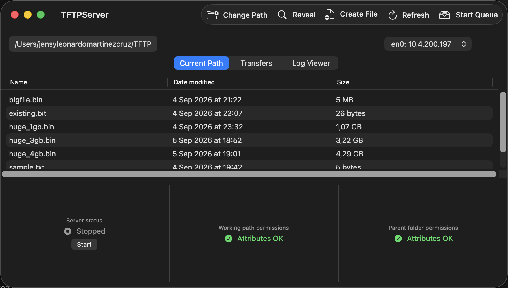

# TFTP Server

A native macOS GUI for the TFTP service already built into macOS.



## What it is

TFTP Server does not reimplement the TFTP protocol. It manages the real `tftpd` binary that ships with macOS via a temporary LaunchDaemon, so every transfer is handled by the same code Apple ships — this app only makes it easy to configure, start, stop, and monitor.

It is a server only: it responds to requests from other devices (routers, switches, PXE clients) that ask it for files. It does not act as a TFTP client.

## Why

TFTP is still the standard way to push firmware and configuration files to network devices — routers, switches, access points, and PXE boot clients. macOS has always shipped a TFTP daemon, but configuring it means the Terminal, `launchctl`, and a handful of flags most people don't remember. This app makes the whole flow — pick a folder, start, copy the IP, configure the device, transfer, stop — possible without ever opening Terminal.

## Features

- **Native `tftpd`, not a reimplementation** — uses Apple's own daemon via a temporary LaunchDaemon, loaded and unloaded on demand.
- **No persistent system registration** — Start/Stop use a one-time native macOS administrator authorization dialog (Touch ID or password), never Terminal `sudo`. Stop removes every trace; nothing is left running in the background after you quit or stop.
- **Real transfer progress** — live percentage, speed, and estimated time remaining, read directly from the transferring process's actual network bytes (not simulated).
- **Cancel without re-authorizing** — the transfer process runs as your own user, not root, so cancelling is instant.
- **Orphaned-server protection** — if the app is force-quit while the server is running, the next launch requires you to explicitly stop the leftover daemon before continuing.
- **Queue progress** — track how many of the files in a folder have been requested at least once, in readable batches of 10.
- **Transfer history** — a running log of every transfer this session: filename, direction, size, status, duration.
- **Built-in Help** — a searchable in-app Help window covering usage, security, and the relevant parts of the TFTP protocol (RFC 1350 and its extensions).

## Requirements

- macOS 13 (Ventura) or later, Apple Silicon.
- Administrator access on the Mac (required by macOS to bind the TFTP service, not by this app).

## Building

This project uses [XcodeGen](https://github.com/yonaskolb/XcodeGen) to generate the Xcode project from `project.yml`.

```bash
brew install xcodegen
xcodegen generate
open TFTPServer.xcodeproj
```

Alternatively, open the generated `TFTPServer.xcodeproj` directly if it's already present in this repository.

## Security

TFTP is an unauthenticated, unencrypted protocol from 1980. See [SECURITY.md](SECURITY.md) for the full threat model and reporting process. In short: only run this on trusted, isolated networks, and never expose it to the open internet.

## License

GNU General Public License v3.0 or later — see [LICENSE](LICENSE).
